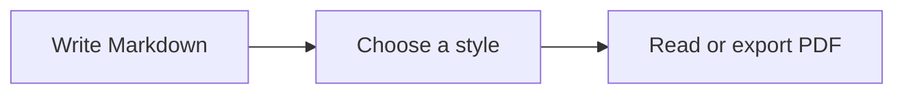

# Inline styles demo

Subtle colour for terminology and phrases. Each occurrence is tagged explicitly.

## Three treatments

We call this a `bounded context`{.concept}. It keeps its monospace font, with
plain coloured text and no badge. An untagged `bounded context` stays ordinary code.

[A gentle note can highlight an entire phrase]{.note} with a faint background.
The font size and weight stay the same as the surrounding text.

[Review the retention policy before publishing]{.warning} uses a fine coloured
underline. Its text keeps the normal document colour.

Use [a **formatted phrase** with `inline code`]{.concept} when useful, or nest
[a note containing [an important detail]{.warning}]{.note}.

## Built-in palette

No metadata is needed for these muted colours:

[Blue]{.blue}, [purple]{.purple}, [red]{.red}, [orange]{.orange},
[green]{.green}, [teal]{.teal}, [pink]{.pink}, [yellow]{.yellow}, [gray]{.gray}.

[A custom hex colour]{.custom} also has an explicit colour for dark mode.
Other styles adapt automatically when you toggle the viewer theme.

## [Styled headings]{.concept} and `terms`{.concept}

The contents list and PDF bookmarks show clean heading text. Their links and
printed page numbers still point to the correct section.

| Term | Meaning | Review |
| --- | --- | --- |
| `aggregate`{.concept} | A [consistency boundary]{.note} | [Check invariants]{.warning} |
| `event`{.concept} | Something that happened | Approved |

## Ordinary Markdown

[Links still work](https://example.com). **Bold**, *italics* and ordinary
`inline code` keep their usual appearance.

Escaping works too: \[literal text]{.blue} and `literal code`\{.blue}.
An unknown tag stays visible: [unrecognised]{.unknown}.

Fenced code shows literal syntax:

```markdown
A `new term`{.concept} appears here.
[A short note]{.note} and [an underlined warning]{.warning}.
```


