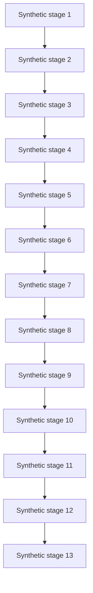

# Synthetic PDF layout test

This file contains generated dummy data only. Body text should stay at ten points even when the viewer is zoomed or uses a large screen theme.

## Long paragraphs and links

A very long link must wrap without widening the paper: https://example.invalid/long-component-0/long-component-1/long-component-2/long-component-3/long-component-4/long-component-5/long-component-6/long-component-7/long-component-8/long-component-9/long-component-10/long-component-11/long-component-12/long-component-13/long-component-14/long-component-15/long-component-16/long-component-17/long-component-18/long-component-19/long-component-20/long-component-21/long-component-22/long-component-23/long-component-24/long-component-25/long-component-26/long-component-27/long-component-28/long-component-29

## Wide table

| Item | Description | URL | Jan | Feb | Mar | Apr | May | Jun | Jul | Aug | Sep |
| --- | --- | --- | --- | --- | --- | --- | --- | --- | --- | --- | --- |
| Dummy row 1 | A longer explanation for sample item 1, which should have more room than the numeric values. | https://example.invalid/reference/item-1/a-long-component | 12 | 34 | 56 | 78 | 90 | 11 | 22 | 33 | 44 |
| Dummy row 2 | A longer explanation for sample item 2, which should have more room than the numeric values. | https://example.invalid/reference/item-2/a-long-component | 12 | 34 | 56 | 78 | 90 | 11 | 22 | 33 | 44 |
| Dummy row 3 | A longer explanation for sample item 3, which should have more room than the numeric values. | https://example.invalid/reference/item-3/a-long-component | 12 | 34 | 56 | 78 | 90 | 11 | 22 | 33 | 44 |
| Dummy row 4 | A longer explanation for sample item 4, which should have more room than the numeric values. | https://example.invalid/reference/item-4/a-long-component | 12 | 34 | 56 | 78 | 90 | 11 | 22 | 33 | 44 |
| Dummy row 5 | A longer explanation for sample item 5, which should have more room than the numeric values. | https://example.invalid/reference/item-5/a-long-component | 12 | 34 | 56 | 78 | 90 | 11 | 22 | 33 | 44 |
| Dummy row 6 | A longer explanation for sample item 6, which should have more room than the numeric values. | https://example.invalid/reference/item-6/a-long-component | 12 | 34 | 56 | 78 | 90 | 11 | 22 | 33 | 44 |
| Dummy row 7 | A longer explanation for sample item 7, which should have more room than the numeric values. | https://example.invalid/reference/item-7/a-long-component | 12 | 34 | 56 | 78 | 90 | 11 | 22 | 33 | 44 |
| Dummy row 8 | A longer explanation for sample item 8, which should have more room than the numeric values. | https://example.invalid/reference/item-8/a-long-component | 12 | 34 | 56 | 78 | 90 | 11 | 22 | 33 | 44 |
| Dummy row 9 | A longer explanation for sample item 9, which should have more room than the numeric values. | https://example.invalid/reference/item-9/a-long-component | 12 | 34 | 56 | 78 | 90 | 11 | 22 | 33 | 44 |
| Dummy row 10 | A longer explanation for sample item 10, which should have more room than the numeric values. | https://example.invalid/reference/item-10/a-long-component | 12 | 34 | 56 | 78 | 90 | 11 | 22 | 33 | 44 |
| Dummy row 11 | A longer explanation for sample item 11, which should have more room than the numeric values. | https://example.invalid/reference/item-11/a-long-component | 12 | 34 | 56 | 78 | 90 | 11 | 22 | 33 | 44 |
| Dummy row 12 | A longer explanation for sample item 12, which should have more room than the numeric values. | https://example.invalid/reference/item-12/a-long-component | 12 | 34 | 56 | 78 | 90 | 11 | 22 | 33 | 44 |
| Dummy row 13 | A longer explanation for sample item 13, which should have more room than the numeric values. | https://example.invalid/reference/item-13/a-long-component | 12 | 34 | 56 | 78 | 90 | 11 | 22 | 33 | 44 |
| Dummy row 14 | A longer explanation for sample item 14, which should have more room than the numeric values. | https://example.invalid/reference/item-14/a-long-component | 12 | 34 | 56 | 78 | 90 | 11 | 22 | 33 | 44 |
| Dummy row 15 | A longer explanation for sample item 15, which should have more room than the numeric values. | https://example.invalid/reference/item-15/a-long-component | 12 | 34 | 56 | 78 | 90 | 11 | 22 | 33 | 44 |
| Dummy row 16 | A longer explanation for sample item 16, which should have more room than the numeric values. | https://example.invalid/reference/item-16/a-long-component | 12 | 34 | 56 | 78 | 90 | 11 | 22 | 33 | 44 |
| Dummy row 17 | A longer explanation for sample item 17, which should have more room than the numeric values. | https://example.invalid/reference/item-17/a-long-component | 12 | 34 | 56 | 78 | 90 | 11 | 22 | 33 | 44 |
| Dummy row 18 | A longer explanation for sample item 18, which should have more room than the numeric values. | https://example.invalid/reference/item-18/a-long-component | 12 | 34 | 56 | 78 | 90 | 11 | 22 | 33 | 44 |
| Dummy row 19 | A longer explanation for sample item 19, which should have more room than the numeric values. | https://example.invalid/reference/item-19/a-long-component | 12 | 34 | 56 | 78 | 90 | 11 | 22 | 33 | 44 |
| Dummy row 20 | A longer explanation for sample item 20, which should have more room than the numeric values. | https://example.invalid/reference/item-20/a-long-component | 12 | 34 | 56 | 78 | 90 | 11 | 22 | 33 | 44 |
| Dummy row 21 | A longer explanation for sample item 21, which should have more room than the numeric values. | https://example.invalid/reference/item-21/a-long-component | 12 | 34 | 56 | 78 | 90 | 11 | 22 | 33 | 44 |
| Dummy row 22 | A longer explanation for sample item 22, which should have more room than the numeric values. | https://example.invalid/reference/item-22/a-long-component | 12 | 34 | 56 | 78 | 90 | 11 | 22 | 33 | 44 |
| Dummy row 23 | A longer explanation for sample item 23, which should have more room than the numeric values. | https://example.invalid/reference/item-23/a-long-component | 12 | 34 | 56 | 78 | 90 | 11 | 22 | 33 | 44 |
| Dummy row 24 | A longer explanation for sample item 24, which should have more room than the numeric values. | https://example.invalid/reference/item-24/a-long-component | 12 | 34 | 56 | 78 | 90 | 11 | 22 | 33 | 44 |
| Dummy row 25 | A longer explanation for sample item 25, which should have more room than the numeric values. | https://example.invalid/reference/item-25/a-long-component | 12 | 34 | 56 | 78 | 90 | 11 | 22 | 33 | 44 |
| Dummy row 26 | A longer explanation for sample item 26, which should have more room than the numeric values. | https://example.invalid/reference/item-26/a-long-component | 12 | 34 | 56 | 78 | 90 | 11 | 22 | 33 | 44 |
| Dummy row 27 | A longer explanation for sample item 27, which should have more room than the numeric values. | https://example.invalid/reference/item-27/a-long-component | 12 | 34 | 56 | 78 | 90 | 11 | 22 | 33 | 44 |
| Dummy row 28 | A longer explanation for sample item 28, which should have more room than the numeric values. | https://example.invalid/reference/item-28/a-long-component | 12 | 34 | 56 | 78 | 90 | 11 | 22 | 33 | 44 |
| Dummy row 29 | A longer explanation for sample item 29, which should have more room than the numeric values. | https://example.invalid/reference/item-29/a-long-component | 12 | 34 | 56 | 78 | 90 | 11 | 22 | 33 | 44 |
| Dummy row 30 | A longer explanation for sample item 30, which should have more room than the numeric values. | https://example.invalid/reference/item-30/a-long-component | 12 | 34 | 56 | 78 | 90 | 11 | 22 | 33 | 44 |
| Dummy row 31 | A longer explanation for sample item 31, which should have more room than the numeric values. | https://example.invalid/reference/item-31/a-long-component | 12 | 34 | 56 | 78 | 90 | 11 | 22 | 33 | 44 |
| Dummy row 32 | A longer explanation for sample item 32, which should have more room than the numeric values. | https://example.invalid/reference/item-32/a-long-component | 12 | 34 | 56 | 78 | 90 | 11 | 22 | 33 | 44 |
| Dummy row 33 | A longer explanation for sample item 33, which should have more room than the numeric values. | https://example.invalid/reference/item-33/a-long-component | 12 | 34 | 56 | 78 | 90 | 11 | 22 | 33 | 44 |
| Dummy row 34 | A longer explanation for sample item 34, which should have more room than the numeric values. | https://example.invalid/reference/item-34/a-long-component | 12 | 34 | 56 | 78 | 90 | 11 | 22 | 33 | 44 |
| Dummy row 35 | A longer explanation for sample item 35, which should have more room than the numeric values. | https://example.invalid/reference/item-35/a-long-component | 12 | 34 | 56 | 78 | 90 | 11 | 22 | 33 | 44 |
| Dummy row 36 | A longer explanation for sample item 36, which should have more room than the numeric values. | https://example.invalid/reference/item-36/a-long-component | 12 | 34 | 56 | 78 | 90 | 11 | 22 | 33 | 44 |
| Dummy row 37 | A longer explanation for sample item 37, which should have more room than the numeric values. | https://example.invalid/reference/item-37/a-long-component | 12 | 34 | 56 | 78 | 90 | 11 | 22 | 33 | 44 |
| Dummy row 38 | A longer explanation for sample item 38, which should have more room than the numeric values. | https://example.invalid/reference/item-38/a-long-component | 12 | 34 | 56 | 78 | 90 | 11 | 22 | 33 | 44 |
| Dummy row 39 | A longer explanation for sample item 39, which should have more room than the numeric values. | https://example.invalid/reference/item-39/a-long-component | 12 | 34 | 56 | 78 | 90 | 11 | 22 | 33 | 44 |
| Dummy row 40 | A longer explanation for sample item 40, which should have more room than the numeric values. | https://example.invalid/reference/item-40/a-long-component | 12 | 34 | 56 | 78 | 90 | 11 | 22 | 33 | 44 |

Last table marker: TABLE_END.

## Code across pages

```text
line_01 = "Sample code should wrap rather than extend off the page. Sample code should wrap rather than extend off the page. Sample code should wrap rather than extend off the page. Sample code should wrap rather than extend off the page. CODE_ROW_01"
line_02 = "Sample code should wrap rather than extend off the page. Sample code should wrap rather than extend off the page. Sample code should wrap rather than extend off the page. Sample code should wrap rather than extend off the page. CODE_ROW_02"
line_03 = "Sample code should wrap rather than extend off the page. Sample code should wrap rather than extend off the page. Sample code should wrap rather than extend off the page. Sample code should wrap rather than extend off the page. CODE_ROW_03"
line_04 = "Sample code should wrap rather than extend off the page. Sample code should wrap rather than extend off the page. Sample code should wrap rather than extend off the page. Sample code should wrap rather than extend off the page. CODE_ROW_04"
line_05 = "Sample code should wrap rather than extend off the page. Sample code should wrap rather than extend off the page. Sample code should wrap rather than extend off the page. Sample code should wrap rather than extend off the page. CODE_ROW_05"
line_06 = "Sample code should wrap rather than extend off the page. Sample code should wrap rather than extend off the page. Sample code should wrap rather than extend off the page. Sample code should wrap rather than extend off the page. CODE_ROW_06"
line_07 = "Sample code should wrap rather than extend off the page. Sample code should wrap rather than extend off the page. Sample code should wrap rather than extend off the page. Sample code should wrap rather than extend off the page. CODE_ROW_07"
line_08 = "Sample code should wrap rather than extend off the page. Sample code should wrap rather than extend off the page. Sample code should wrap rather than extend off the page. Sample code should wrap rather than extend off the page. CODE_ROW_08"
line_09 = "Sample code should wrap rather than extend off the page. Sample code should wrap rather than extend off the page. Sample code should wrap rather than extend off the page. Sample code should wrap rather than extend off the page. CODE_ROW_09"
line_10 = "Sample code should wrap rather than extend off the page. Sample code should wrap rather than extend off the page. Sample code should wrap rather than extend off the page. Sample code should wrap rather than extend off the page. CODE_ROW_10"
line_11 = "Sample code should wrap rather than extend off the page. Sample code should wrap rather than extend off the page. Sample code should wrap rather than extend off the page. Sample code should wrap rather than extend off the page. CODE_ROW_11"
line_12 = "Sample code should wrap rather than extend off the page. Sample code should wrap rather than extend off the page. Sample code should wrap rather than extend off the page. Sample code should wrap rather than extend off the page. CODE_ROW_12"
line_13 = "Sample code should wrap rather than extend off the page. Sample code should wrap rather than extend off the page. Sample code should wrap rather than extend off the page. Sample code should wrap rather than extend off the page. CODE_ROW_13"
line_14 = "Sample code should wrap rather than extend off the page. Sample code should wrap rather than extend off the page. Sample code should wrap rather than extend off the page. Sample code should wrap rather than extend off the page. CODE_ROW_14"
line_15 = "Sample code should wrap rather than extend off the page. Sample code should wrap rather than extend off the page. Sample code should wrap rather than extend off the page. Sample code should wrap rather than extend off the page. CODE_ROW_15"
line_16 = "Sample code should wrap rather than extend off the page. Sample code should wrap rather than extend off the page. Sample code should wrap rather than extend off the page. Sample code should wrap rather than extend off the page. CODE_ROW_16"
line_17 = "Sample code should wrap rather than extend off the page. Sample code should wrap rather than extend off the page. Sample code should wrap rather than extend off the page. Sample code should wrap rather than extend off the page. CODE_ROW_17"
line_18 = "Sample code should wrap rather than extend off the page. Sample code should wrap rather than extend off the page. Sample code should wrap rather than extend off the page. Sample code should wrap rather than extend off the page. CODE_ROW_18"
line_19 = "Sample code should wrap rather than extend off the page. Sample code should wrap rather than extend off the page. Sample code should wrap rather than extend off the page. Sample code should wrap rather than extend off the page. CODE_ROW_19"
line_20 = "Sample code should wrap rather than extend off the page. Sample code should wrap rather than extend off the page. Sample code should wrap rather than extend off the page. Sample code should wrap rather than extend off the page. CODE_ROW_20"
line_21 = "Sample code should wrap rather than extend off the page. Sample code should wrap rather than extend off the page. Sample code should wrap rather than extend off the page. Sample code should wrap rather than extend off the page. CODE_ROW_21"
line_22 = "Sample code should wrap rather than extend off the page. Sample code should wrap rather than extend off the page. Sample code should wrap rather than extend off the page. Sample code should wrap rather than extend off the page. CODE_ROW_22"
line_23 = "Sample code should wrap rather than extend off the page. Sample code should wrap rather than extend off the page. Sample code should wrap rather than extend off the page. Sample code should wrap rather than extend off the page. CODE_ROW_23"
line_24 = "Sample code should wrap rather than extend off the page. Sample code should wrap rather than extend off the page. Sample code should wrap rather than extend off the page. Sample code should wrap rather than extend off the page. CODE_ROW_24"
line_25 = "Sample code should wrap rather than extend off the page. Sample code should wrap rather than extend off the page. Sample code should wrap rather than extend off the page. Sample code should wrap rather than extend off the page. CODE_ROW_25"
line_26 = "Sample code should wrap rather than extend off the page. Sample code should wrap rather than extend off the page. Sample code should wrap rather than extend off the page. Sample code should wrap rather than extend off the page. CODE_ROW_26"
line_27 = "Sample code should wrap rather than extend off the page. Sample code should wrap rather than extend off the page. Sample code should wrap rather than extend off the page. Sample code should wrap rather than extend off the page. CODE_ROW_27"
line_28 = "Sample code should wrap rather than extend off the page. Sample code should wrap rather than extend off the page. Sample code should wrap rather than extend off the page. Sample code should wrap rather than extend off the page. CODE_ROW_28"
line_29 = "Sample code should wrap rather than extend off the page. Sample code should wrap rather than extend off the page. Sample code should wrap rather than extend off the page. Sample code should wrap rather than extend off the page. CODE_ROW_29"
line_30 = "Sample code should wrap rather than extend off the page. Sample code should wrap rather than extend off the page. Sample code should wrap rather than extend off the page. Sample code should wrap rather than extend off the page. CODE_ROW_30"
line_31 = "Sample code should wrap rather than extend off the page. Sample code should wrap rather than extend off the page. Sample code should wrap rather than extend off the page. Sample code should wrap rather than extend off the page. CODE_ROW_31"
line_32 = "Sample code should wrap rather than extend off the page. Sample code should wrap rather than extend off the page. Sample code should wrap rather than extend off the page. Sample code should wrap rather than extend off the page. CODE_ROW_32"
line_33 = "Sample code should wrap rather than extend off the page. Sample code should wrap rather than extend off the page. Sample code should wrap rather than extend off the page. Sample code should wrap rather than extend off the page. CODE_ROW_33"
line_34 = "Sample code should wrap rather than extend off the page. Sample code should wrap rather than extend off the page. Sample code should wrap rather than extend off the page. Sample code should wrap rather than extend off the page. CODE_ROW_34"
line_35 = "Sample code should wrap rather than extend off the page. Sample code should wrap rather than extend off the page. Sample code should wrap rather than extend off the page. Sample code should wrap rather than extend off the page. CODE_ROW_35"
line_36 = "Sample code should wrap rather than extend off the page. Sample code should wrap rather than extend off the page. Sample code should wrap rather than extend off the page. Sample code should wrap rather than extend off the page. CODE_ROW_36"
line_37 = "Sample code should wrap rather than extend off the page. Sample code should wrap rather than extend off the page. Sample code should wrap rather than extend off the page. Sample code should wrap rather than extend off the page. CODE_ROW_37"
line_38 = "Sample code should wrap rather than extend off the page. Sample code should wrap rather than extend off the page. Sample code should wrap rather than extend off the page. Sample code should wrap rather than extend off the page. CODE_ROW_38"
line_39 = "Sample code should wrap rather than extend off the page. Sample code should wrap rather than extend off the page. Sample code should wrap rather than extend off the page. Sample code should wrap rather than extend off the page. CODE_ROW_39"
line_40 = "Sample code should wrap rather than extend off the page. Sample code should wrap rather than extend off the page. Sample code should wrap rather than extend off the page. Sample code should wrap rather than extend off the page. CODE_ROW_40"
line_41 = "Sample code should wrap rather than extend off the page. Sample code should wrap rather than extend off the page. Sample code should wrap rather than extend off the page. Sample code should wrap rather than extend off the page. CODE_ROW_41"
line_42 = "Sample code should wrap rather than extend off the page. Sample code should wrap rather than extend off the page. Sample code should wrap rather than extend off the page. Sample code should wrap rather than extend off the page. CODE_ROW_42"
line_43 = "Sample code should wrap rather than extend off the page. Sample code should wrap rather than extend off the page. Sample code should wrap rather than extend off the page. Sample code should wrap rather than extend off the page. CODE_ROW_43"
line_44 = "Sample code should wrap rather than extend off the page. Sample code should wrap rather than extend off the page. Sample code should wrap rather than extend off the page. Sample code should wrap rather than extend off the page. CODE_ROW_44"
line_45 = "Sample code should wrap rather than extend off the page. Sample code should wrap rather than extend off the page. Sample code should wrap rather than extend off the page. Sample code should wrap rather than extend off the page. CODE_ROW_45"
```

Last code marker: CODE_END.

## Large diagrams




## Text & special characters

### Repeated heading

First copy.

### Repeated heading

Second copy.

### Literal `<tag>` & Café

A heading with text that needs escaping.

### Nested contents entry 1

Generated paragraph 1 for checking a long contents page and PDF bookmarks.

### Nested contents entry 2

Generated paragraph 2 for checking a long contents page and PDF bookmarks.

### Nested contents entry 3

Generated paragraph 3 for checking a long contents page and PDF bookmarks.

### Nested contents entry 4

Generated paragraph 4 for checking a long contents page and PDF bookmarks.

### Nested contents entry 5

Generated paragraph 5 for checking a long contents page and PDF bookmarks.

### Nested contents entry 6

Generated paragraph 6 for checking a long contents page and PDF bookmarks.

### Nested contents entry 7

Generated paragraph 7 for checking a long contents page and PDF bookmarks.

### Nested contents entry 8

Generated paragraph 8 for checking a long contents page and PDF bookmarks.

### Nested contents entry 9

Generated paragraph 9 for checking a long contents page and PDF bookmarks.

### Nested contents entry 10

Generated paragraph 10 for checking a long contents page and PDF bookmarks.

### Nested contents entry 11

Generated paragraph 11 for checking a long contents page and PDF bookmarks.

### Nested contents entry 12

Generated paragraph 12 for checking a long contents page and PDF bookmarks.

### Nested contents entry 13

Generated paragraph 13 for checking a long contents page and PDF bookmarks.

### Nested contents entry 14

Generated paragraph 14 for checking a long contents page and PDF bookmarks.

### Nested contents entry 15

Generated paragraph 15 for checking a long contents page and PDF bookmarks.

### Nested contents entry 16

Generated paragraph 16 for checking a long contents page and PDF bookmarks.

### Nested contents entry 17

Generated paragraph 17 for checking a long contents page and PDF bookmarks.

### Nested contents entry 18

Generated paragraph 18 for checking a long contents page and PDF bookmarks.

### Nested contents entry 19

Generated paragraph 19 for checking a long contents page and PDF bookmarks.

### Nested contents entry 20

Generated paragraph 20 for checking a long contents page and PDF bookmarks.

### Nested contents entry 21

Generated paragraph 21 for checking a long contents page and PDF bookmarks.

### Nested contents entry 22

Generated paragraph 22 for checking a long contents page and PDF bookmarks.

### Nested contents entry 23

Generated paragraph 23 for checking a long contents page and PDF bookmarks.

### Nested contents entry 24

Generated paragraph 24 for checking a long contents page and PDF bookmarks.

### Nested contents entry 25

Generated paragraph 25 for checking a long contents page and PDF bookmarks.

### Nested contents entry 26

Generated paragraph 26 for checking a multi-page contents section and PDF bookmarks.

### Nested contents entry 27

Generated paragraph 27 for checking a multi-page contents section and PDF bookmarks.

### Nested contents entry 28

Generated paragraph 28 for checking a multi-page contents section and PDF bookmarks.

### Nested contents entry 29

Generated paragraph 29 for checking a multi-page contents section and PDF bookmarks.

### Nested contents entry 30

Generated paragraph 30 for checking a multi-page contents section and PDF bookmarks.

### Nested contents entry 31

Generated paragraph 31 for checking a multi-page contents section and PDF bookmarks.

### Nested contents entry 32

Generated paragraph 32 for checking a multi-page contents section and PDF bookmarks.

### Nested contents entry 33

Generated paragraph 33 for checking a multi-page contents section and PDF bookmarks.

### Nested contents entry 34

Generated paragraph 34 for checking a multi-page contents section and PDF bookmarks.

### Nested contents entry 35

Generated paragraph 35 for checking a multi-page contents section and PDF bookmarks.

### Nested contents entry 36

Generated paragraph 36 for checking a multi-page contents section and PDF bookmarks.

### Nested contents entry 37

Generated paragraph 37 for checking a multi-page contents section and PDF bookmarks.

### Nested contents entry 38

Generated paragraph 38 for checking a multi-page contents section and PDF bookmarks.

### Nested contents entry 39

Generated paragraph 39 for checking a multi-page contents section and PDF bookmarks.

### Nested contents entry 40

Generated paragraph 40 for checking a multi-page contents section and PDF bookmarks.

### Nested contents entry 41

Generated paragraph 41 for checking a multi-page contents section and PDF bookmarks.

### Nested contents entry 42

Generated paragraph 42 for checking a multi-page contents section and PDF bookmarks.

### Nested contents entry 43

Generated paragraph 43 for checking a multi-page contents section and PDF bookmarks.

### Nested contents entry 44

Generated paragraph 44 for checking a multi-page contents section and PDF bookmarks.

### Nested contents entry 45

Generated paragraph 45 for checking a multi-page contents section and PDF bookmarks.

### Nested contents entry 46

Generated paragraph 46 for checking a multi-page contents section and PDF bookmarks.

### Nested contents entry 47

Generated paragraph 47 for checking a multi-page contents section and PDF bookmarks.

### Nested contents entry 48

Generated paragraph 48 for checking a multi-page contents section and PDF bookmarks.

### Nested contents entry 49

Generated paragraph 49 for checking a multi-page contents section and PDF bookmarks.

### Nested contents entry 50

Generated paragraph 50 for checking a multi-page contents section and PDF bookmarks.

### Nested contents entry 51

Generated paragraph 51 for checking a multi-page contents section and PDF bookmarks.

### Nested contents entry 52

Generated paragraph 52 for checking a multi-page contents section and PDF bookmarks.

### Nested contents entry 53

Generated paragraph 53 for checking a multi-page contents section and PDF bookmarks.

### Nested contents entry 54

Generated paragraph 54 for checking a multi-page contents section and PDF bookmarks.

### Nested contents entry 55

Generated paragraph 55 for checking a multi-page contents section and PDF bookmarks.

### Nested contents entry 56

Generated paragraph 56 for checking a multi-page contents section and PDF bookmarks.

### Nested contents entry 57

Generated paragraph 57 for checking a multi-page contents section and PDF bookmarks.

### Nested contents entry 58

Generated paragraph 58 for checking a multi-page contents section and PDF bookmarks.

### Nested contents entry 59

Generated paragraph 59 for checking a multi-page contents section and PDF bookmarks.

### Nested contents entry 60

Generated paragraph 60 for checking a multi-page contents section and PDF bookmarks.

### Nested contents entry 61

Generated paragraph 61 for checking a multi-page contents section and PDF bookmarks.

### Nested contents entry 62

Generated paragraph 62 for checking a multi-page contents section and PDF bookmarks.

### Nested contents entry 63

Generated paragraph 63 for checking a multi-page contents section and PDF bookmarks.

### Nested contents entry 64

Generated paragraph 64 for checking a multi-page contents section and PDF bookmarks.

### Nested contents entry 65

Generated paragraph 65 for checking a multi-page contents section and PDF bookmarks.

### Nested contents entry 66

Generated paragraph 66 for checking a multi-page contents section and PDF bookmarks.

### Nested contents entry 67

Generated paragraph 67 for checking a multi-page contents section and PDF bookmarks.

### Nested contents entry 68

Generated paragraph 68 for checking a multi-page contents section and PDF bookmarks.

### Nested contents entry 69

Generated paragraph 69 for checking a multi-page contents section and PDF bookmarks.

### Nested contents entry 70

Generated paragraph 70 for checking a multi-page contents section and PDF bookmarks.

### A deliberately long contents heading that wraps onto several lines while preserving its indentation, dotted leader, clickable link, and correctly aligned page number at the right-hand edge of the contents section

This generated heading checks wrapping in a numbered contents entry.

#### Fourth-level heading

A deeper heading in the contents.

##### Fifth-level heading

An even deeper heading in the contents.

###### Sixth-level heading

The deepest Markdown heading in the contents.

## End

Final document marker: STRESS_DOCUMENT_END.
