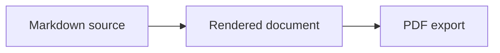
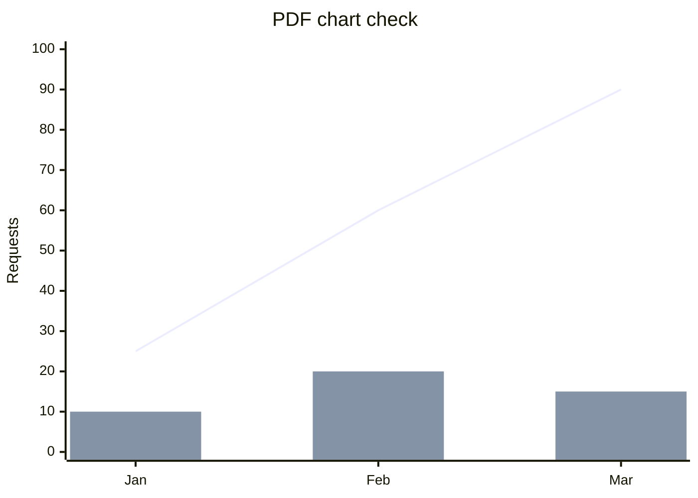

# PDF export check

This document exercises contents links, bookmarks, diagrams, tables and code.

## Diagrams





## Tables & code

| Name | Description | A | B | C | D | E | F |
| --- | --- | --- | --- | --- | --- | --- | --- |
| Long value | A cell that must wrap within the printable width rather than extend beyond the page | 1 | 2 | 3 | 4 | 5 | 6 |
| URL | https://example.com/a/very/long/path/with/many/components/that/needs/to/wrap/on/the/page | 7 | 8 | 9 | 10 | 11 | 12 |

```rust
let message = "A deliberately long code line that should wrap within the printed page and preserve all its words including the final marker CODE_LINE_END";
```

### Repeated heading

First occurrence.

### Repeated heading

Second occurrence. Both contents entries must jump to their own heading.

## Literal text: `<tag>` & Unicode — Café

Special characters in contents labels must remain text.

[Jump back to diagrams](#diagrams).

Final paragraph marker: DOCUMENT_END.
